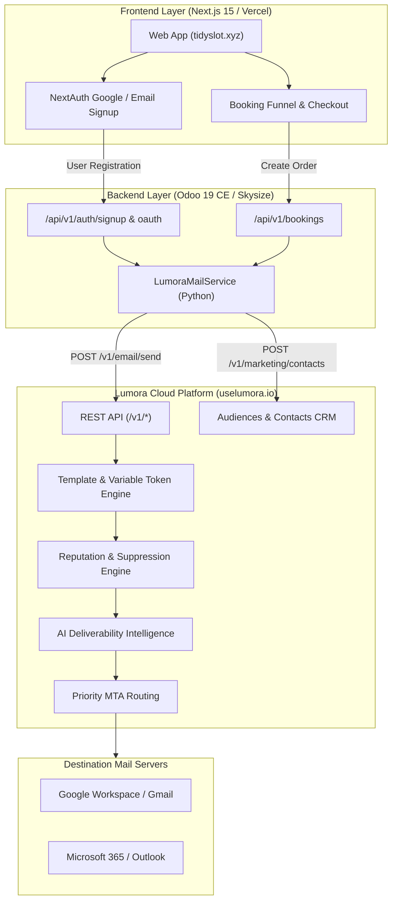
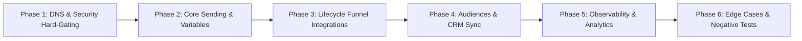

# Lumora QA Master Plan & Platform Deep Dive

> **Project:** Shield Cleaning / TidySlot (`tidyslot.xyz`)  
> **Target Under Test:** Lumora Transactional Email & Lifecycle Platform ([uselumora.io](https://uselumora.io))  
> **QA Plan Level:** Premium Plan ($35/mo) Feature Set  
> **Status:** Phase 1 – Functional & API Testing (Active)  

---

## 1. Executive Summary & Product Deep Dive

### 1.1 What is Lumora?
**Lumora** is a developer-first transactional email and lifecycle delivery platform engineered to compete with platforms like Resend, Postmark, and SendGrid. It solves the developer friction of slow domain verification, poor inbox placement, and fragmented customer audience syncing by combining:
1. **Hard-gated DNS Verification:** Mandatory SPF, DKIM, and DMARC enforcement before sending to protect tenant and platform reputation.
2. **Modern Developer REST API:** Clean, JSON-based endpoints with dual-header authentication (`x-api-key` and `Authorization: Bearer`).
3. **AI Deliverability Intelligence:** Automated spam scoring, bounce explainers, health alerts, and delivery insights.
4. **Unified Audiences & Contacts CRM:** Integrated contact lists, audience segmentation, custom fields, and tagging alongside transactional dispatch.
5. **Dynamic Templating & Variable Engine:** Advanced variable substitution supporting shared tokens (`{{token}}`), `perRecipientVariables`, and system tokens.

### 1.2 The Premium Plan Feature Matrix ($35 / month)
As a **Premium Plan** subscriber, the following capabilities and entitlements are available for QA testing:

| Feature Area | Free / Starter | Premium Plan Entitlement | QA Testing Scope |
| :--- | :--- | :--- | :--- |
| **Sending Volume** | Low / Trial cap | High recurring daily & monthly send limits | Credit reservation & throughput stress tests |
| **Domains** | 1 domain | **3+ verified domains** | Multi-domain sender validation (`mail.tidyslot.xyz`, etc.) |
| **Apps & API Keys** | 1 App / 1 Key | **5 Apps & 5 API Keys** | Key scoping, multi-environment isolation (Dev vs Prod) |
| **Priority Routing** | Standard queue | **Priority delivery routing** | Sub-second delivery latency benchmarks |
| **AI Intelligence** | Basic | **Full AI Deliverability Suite** | Spam pre-flight scoring, bounce diagnostics |
| **Campaigns & Audiences**| Single list | **Unlimited lists, advanced tagging & custom fields** | Customer lifecycle sync from booking platform |
| **Suppression Mgmt** | Basic | **Automated bounce & complaint suppression** | Fault-injection & bounce handling |
| **Relay Options** | REST only | **REST API + SMTP Relay** | Dual-protocol verification |

---

## 2. Platform Architecture & Data Flow



---

## 3. Comprehensive QA Test Suites

We divide the testing into **6 functional phases**, moving from low-level API integrity to full user lifecycle flows and negative testing, before transitioning to UI/UX audit.



---

### Phase 1: Domain Verification & Security Hard-Gating
*Verify that Lumora enforces strict deliverability controls and blocks illicit/unverified senders.*

| Test ID | Test Case | Target Endpoint / Action | Expected Result | Status |
| :--- | :--- | :--- | :--- | :---: |
| **SEC-01** | Unverified Domain Rejection | `POST /v1/email/send` with `from: hello@unverified-domain.com` | `HTTP 403: sender_domain_not_verified` | Passed |
| **SEC-02** | Missing From Parameter | `POST /v1/email/send` without `from` when app default missing | `HTTP 400: missing_from` | Passed |
| **SEC-03** | Verified Domain Dispatch | `POST /v1/email/send` with `from: hello@mail.tidyslot.xyz` | `HTTP 200: { success: true, messageId: "..." }` | Passed |
| **SEC-04** | API Key Authentication | Request with invalid key `esk_invalid...` | `HTTP 401: invalid_api_key` | Passed |
| **SEC-05** | Dual-Auth Header Support | Test `x-api-key: ...` vs `Authorization: Bearer ...` | Both headers authenticate identically | Planned |
| **SEC-06** | Multi-Key Scoping (Premium) | Create 2 separate keys (Dev vs Prod) in Lumora Dashboard | Verify permissions and isolation between apps | Planned |

---

### Phase 2: Core Transactional Sending & Dynamic Variables
*Verify variable rendering, token precedence, and MIME formatting.*

| Test ID | Test Case | Payload & Variables | Expected Result | Status |
| :--- | :--- | :--- | :--- | :---: |
| **VAR-01** | Shared Variables (`variables`) | `subject: "Welcome {{name}}"`, `variables: { name: "Alex" }` | Rendered subject: "Welcome Alex" | Planned |
| **VAR-02** | System Tokens | Include `{{name}}`, `{{email}}`, `{{unsubscribe_url}}` | Automatic substitution per recipient | Planned |
| **VAR-03** | Recipient-Specific Overrides | Send to 2 recipients with `perRecipientVariables` | Recipient A gets custom CTA, Recipient B gets default | Planned |
| **VAR-04** | Fallback Variable Missing | Template has `{{non_existent}}` with no variable passed | Graceful fallback (blank or preserved token, no 500 crash) | Planned |
| **VAR-05** | HTML + Plaintext Multipart | Provide both `html` and `text` payload | Multi-part MIME sent; plaintext clients render `text` | Planned |

---

### Phase 3: Cleaning Platform Lifecycle Integrations
*Test real user journeys in Shield Cleaning.*

| Test ID | Lifecycle Trigger | Shield Cleaning Event | Email Template Dispatched | Status |
| :--- | :--- | :--- | :--- | :---: |
| **APP-01** | User Email Registration | User signs up via `/signup` | Welcome email + account activation button | Verified |
| **APP-02** | Google OAuth Signup | New user signs in via Google | Welcome email + profile synced with Google name | Verified |
| **APP-03** | Password Reset Request | User triggers `/forgot-password` | Secure password reset link with expiration | Verified |
| **APP-04** | Booking Creation | Customer finishes booking wizard (`/booking`) | Booking Confirmation with reference, total price, and slot | Verified |
| **APP-05** | Booking Reschedule/Cancel | Admin/Customer modifies booking date/status | Reschedule notification email | Planned |

---

### Phase 4: Audiences & Contacts CRM Engine
*Test Lumora's marketing and audience synchronization.*

| Test ID | Test Case | Target Endpoint | Validation Criteria | Status |
| :--- | :--- | :--- | :--- | :---: |
| **CRM-01** | Create Marketing List | `POST /v1/marketing/lists` (`"Shield Cleaning VIPs"`) | List ID created and retrievable via `GET /v1/marketing/lists` | Verified |
| **CRM-02** | Contact Upsert on Signup | `POST /v1/marketing/contacts` on user signup | Contact created with tags `['portal-user', 'signup']` | Verified |
| **CRM-03** | Contact Update on Booking | `POST /v1/marketing/contacts` on checkout | Existing contact updated with `tags: ['customer']` & booking stats | Verified |
| **CRM-04** | Batch Contact Import | `POST /v1/marketing/lists/{id}/contacts` | Bulk array of 10+ contacts imported without rate-limit errors | Planned |
| **CRM-05** | Unsubscribe State Sync | Contact status set to `"unsubscribed"` | Excluded from marketing campaigns; transactional still delivers | Planned |

---

### Phase 5: Observability, Delivery Logs & Analytics
*Validate delivery tracking and webhook notification capabilities.*

| Test ID | Test Case | Target Endpoint / Method | Validation Criteria | Status |
| :--- | :--- | :--- | :--- | :---: |
| **OBS-01** | Single Message Status | `GET /v1/messages/{messageId}` | Returns state: `queued` → `sent` → `delivered` | Planned |
| **OBS-02** | Delivery Logs Filtering | `GET /v1/emails/logs?domain=mail.tidyslot.xyz` | Filtered list matching domain and timestamps | Verified |
| **OBS-03** | Aggregated Email Stats | `GET /v1/emails/stats` | Accurate counts for `sent`, `delivered`, `bounced`, `opened` | Verified |
| **OBS-04** | Open & Click Tracking | Recipient opens email & clicks booking link | Webhooks / stats log `opened: 1`, `clicked: 1` | Planned |
| **OBS-05** | AI Health Score (Premium) | Inspect Lumora Dashboard Deliverability Health | Deliverability score calculated based on domain auth & bounce rate | Planned |

---

### Phase 6: Edge Cases, Negative Testing & Fault Injection
*Probe system resilience, input sanitization, and error reporting.*

| Test ID | Fault / Edge Case | Method | Expected System Behavior |
| :--- | :--- | :--- | :--- |
| **ERR-01** | Empty / Malformed Email | Send to `"invalid-email"` | `HTTP 400: invalid_recipient` |
| **ERR-02** | Large HTML Payload | Send email with > 500KB HTML body | Clear error or graceful compression handling |
| **ERR-03** | Credit Reservation Exhaustion | Exceed plan sending credits | `HTTP 402: insufficient_credits` or queued with warning |
| **ERR-04** | Spam Trigger Words (AI Test) | Body with aggressive spam keywords ("FREE $$$ WINNER") | AI Deliverability Intelligence flags low score / spam risk |
| **ERR-05** | Known Bounced Address | Send to an address previously marked bounced | Automatic suppression (does not attempt external SMTP send) |

---

## 4. Test Harness Scripting

To execute repeatable automated QA runs, we use our modular Python test runner:
[`backend/cleaning_booking/services/lumora_test.py`](file:///\\wsl.localhost\Debian\home\xx\dev\odoo\odoo_19\custom_addons\cleaning-service-booking-platform\backend\cleaning_booking\services\lumora_test.py)

### Execution Command:
```bash
python3 backend/cleaning_booking/services/lumora_test.py [recipient_email] [from_email]
```

### Coverage Report Template:
Every QA cycle will produce an output log recording:
1. `API Key Validation & Scope`
2. `Domain DNS Hard-Gating (Negative test)`
3. `Transactional Dispatch (Welcome, Reset, Booking)`
4. `Variable Engine Verification`
5. `Audiences & Contact Upsert Verification`
6. `Analytics & Stats Integrity`

---

## 5. Phase 2 Roadmap: Lumora UI/UX Audit

Once all backend and API functional test cases (Phases 1–6) are complete and documented, we will transition to the **UI/UX Audit** in the Lumora Dashboard:
1. **Onboarding UX:** Ease of DNS configuration and auto-verification feedback.
2. **Dashboard Visualizations:** Responsiveness of delivery charts, logs, and search filters.
3. **Template Builder:** Template authoring, variable placeholder tagging, and real-time preview.
4. **Audience Management:** Filter usability, tag editing, and contact search performance.
5. **Billing & Credit Management:** Clarity of usage meters, credit reservation warnings, and invoice history.

